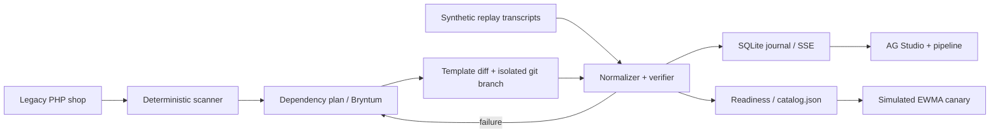

# Sundown

**Legacy checkout → Orders v2 → agent-ready, with proof.**

Sundown inventories legacy PayPal usage, creates a dependency-aware migration plan, writes a reviewable Orders v2 demo-shop migration, and compares six normalized checkout scenarios. The default workspace needs zero credentials. Its synthetic replay fixtures deliberately expose a duplicate-callback defect so the verifier and Planner's schedule response can be inspected.

## Two-minute quickstart

Requires Node.js **24** (built-in SQLite) and pnpm **11.25.0** (recorded in `packageManager`).

```sh
pnpm install
pnpm seed
pnpm dev
```

Open http://localhost:3000 for the landing page, or http://localhost:3000/overview for the workspace. Open **Parity testing → Run parity check**, then **Migration plan → Review & apply diff**, apply the template, and inspect **Agent readiness**. Seed is idempotent; the UI can reset replay flags. SQLite state, reports, branch and generated catalog live under ignored `workspace/`.

```sh
pnpm typecheck
pnpm lint
pnpm test
pnpm build
pnpm start
# PHP legacy shop plus web, with durable volumes:
docker compose up --build
```

PHP shop is at http://localhost:8080. Application and PHP shop use distinct SQLite files. Copy `.env.example` to `apps/web/.env.local` for web-only credentials; exporting variables also works. The web app and live runner read the root `.env.local`; explicitly exported variables and `apps/web/.env.local` take precedence. Keep secrets out of `.env.example`. Docker defaults to replay. Inject secrets with your deployment secret store if enabling sandbox SDK endpoints.

## Shopping agent demo

Open `/agent-demo` after applying the migration. The deterministic shopping policy inspects the legacy source and rejects its NVP/IPN contract with a visible reason. The migrated shop buys one Horizon cup, USD 24.00, through the official [PayPal Agent Toolkit](https://github.com/paypal/agent-toolkit/tree/main/typescript). Tool calls are restricted to `create_order`, `pay_order`, and `get_order`, with sandbox context explicitly enabled. This uses the toolkit function interface; it does not claim a remote MCP session or an LLM-driven buying decision.

With no credentials, choose **Run Simulated checkout**. Creation, approval, capture and webhook are labelled **Simulated**, use `SIM-` IDs, and persist a PAID order through the simulation-only event handler. No PayPal requests occur. The shop DB is the `agent_shop_orders` table in `workspace/sundown.sqlite`, shared with the web app, distinct from the standalone PHP shop database.

For real sandbox execution, set `PAYPAL_MODE=live`, `PAYPAL_CLIENT_ID`, `PAYPAL_CLIENT_SECRET`, and `PAYPAL_WEBHOOK_ID` in `apps/web/.env.local`, restart the server, and register a publicly reachable HTTPS `/api/webhooks` URL for `PAYMENT.CAPTURE.COMPLETED`. Select **Run PayPal sandbox**, open the returned approval link, approve as a sandbox buyer, then select **Capture approved order**. Capture changes the DB to AWAITING_WEBHOOK; only a signature-verified completion event with matching order, amount, currency and capture marks it PAID. Browser ownership, durable request IDs and webhook deduplication prevent cross-browser capture and duplicate settlement. A failed sandbox call is shown as an error; choose the separate Simulated run if the sandbox cannot be used. No real sandbox transaction is claimed by credential-free tests.

## Minimal live sandbox run

Save matching **Sandbox** app credentials in the ignored root `.env.local` (the Secret is different from the client ID). Automated approval additionally needs a sandbox Personal account's `PAYPAL_BUYER_EMAIL` and `PAYPAL_BUYER_PASSWORD`; headed manual approval lets you enter them in Chrome yourself. Never put real keys in `.env.example`.

```dotenv
PAYPAL_MODE=live
PAYPAL_CLIENT_ID=<sandbox app client ID>
PAYPAL_CLIENT_SECRET=<same app's separate secret>
PAYPAL_BUYER_EMAIL=<sandbox personal account email>
PAYPAL_BUYER_PASSWORD=<sandbox personal account password>
OPENROUTER_API_KEY=<OpenRouter key>
LLM_MODEL=openrouter/auto
```

```sh
pnpm dev
# In a second terminal:
pnpm live:sandbox
```

For manual buyer approval in a visible Chrome window, run `pnpm live:sandbox:headed` instead. The migrated-shop runner opens each PayPal sandbox approval URL and waits up to 15 minutes for you to log in, handle any security challenge and approve. It does not fill or click PayPal controls. Buyer credentials are not required for these manual approvals. Keep the process running: after PayPal returns with the matching order token, the runner captures, waits for a verified webhook to settle the shop DB, and requests the USD 12.00 partial refund in the refund scenario. You approve two separate USD 24.00 sandbox orders. Legacy NVP checks also wait for manual approval in headed mode. Use `pnpm live:legacy:headed` to retry only legacy NVP while preserving the last migrated-shop receipts.

The runner creates two USD 24.00 orders on the migrated web shop, drives PayPal buyer approval with Playwright, captures, and waits for a real signature-verified webhook to mark the order PAID in the existing shop DB. The refund scenario then requests USD 12.00 and retains the real refund ID/status. It reuses the existing toolkit/SDK and settlement functions. IDs are saved immediately after each completed step, even if a later step fails.

Prerequisites: PHP with curl/PDO SQLite, Chromium or Google Chrome, and Cloudflare's `cloudflared`. The local workspace installations are detected automatically; `PHP_BINARY`, `SUNDOWN_BROWSER_EXECUTABLE`, and `CLOUDFLARED_BINARY` can override paths. Otherwise install Chromium with `pnpm exec playwright install chromium`. `SUNDOWN_HEADED=true` displays the test browser. The runner stops at PayPal security challenges; it does not bypass them.

For webhook delivery the runner starts an isolated loopback receiver, opens a temporary Cloudflare tunnel to **only that receiver**, registers a sandbox `PAYMENT.CAPTURE.COMPLETED` webhook, verifies PayPal signatures, and atomically settles matching orders. It does not expose dashboard/admin routes. The temporary webhook, tunnel, PHP server and browser are cleaned up after the run. No existing registered webhook is modified.

The legacy shop is started with `php -S` on a loopback port. Supply its separate `PAYPAL_NVP_USER`, `PAYPAL_NVP_PWD` and `PAYPAL_NVP_SIGNATURE` to execute NVP approval/capture/refund. If PayPal rejects a legacy call, a credential-redacted response transcript (HTTP status, PayPal error code/message and correlation ID) is retained, read back, hashed, and labelled **replayed from recorded transcript**. This replays the recorded rejection; it does not fabricate a successful legacy outcome. Missing NVP credentials are labelled **Not run**, because no genuine rejection/transcript exists.

Reports live under `workspace/live-sandbox/<run-id>/report.json` and feed the Migration Passport. Each side/scenario has its own evidence source. Only successful, approved, webhook-settled migrated scenarios get **Live sandbox**; refund also requires a real completed refund ID. Pending/failed attempts keep their IDs and diagnostic labels. Cancellation, decline, duplicate callback and rounding stay **Replay**. An incomplete run exits 1 and cannot establish parity. The passport is reissued with the latest evidence automatically.

## Business intake and judge walkthrough

Start at `/connect`. The operator can enter a business name and assess its actual PHP/JS/TS/TSX/HTML checkout source. Up to ten files are accepted (100 KiB each; 300 KiB total). Findings retain file/line references and suggested review dependencies. Download a JSON assessment with source hashes. Raw code and excerpts are never stored or executed. Zero findings does not certify readiness. Uploaded assessments remain separate from Horizon's source, catalog, replay fixtures and live payment receipts. This is an operator-managed workspace, not self-service multi-tenant SaaS.

Optional PayPal partner onboarding uses sandbox Partner Referrals and server-verified merchant permissions. It requires approved partner access plus `PAYPAL_PARTNER_CLIENT_ID`, `PAYPAL_PARTNER_CLIENT_SECRET`, `PAYPAL_PARTNER_ID` and `PAYPAL_PARTNER_BN_CODE`, with `SUNDOWN_APP_URL` as the callback origin. Standard checkout credentials do not substitute for partner credentials. Without partner configuration the UI shows setup required and creates no fake connections. Sellers approve on PayPal; Sundown never collects their password. Callback state is signed, expiring and single-use; browser return flags cannot mark a seller connected. Connection status is an as-of snapshot, not ongoing revocation monitoring or proof of checkout migration. Review PayPal's [seller onboarding guide](https://developer.paypal.com/platforms/seller-onboarding/before-payment/) before enabling partner access.

The workspace journey is Connect → Inspect → Plan → Verify → Share. “Run demo tests” executes synthetic replay explicitly, even with sandbox mode enabled, while preserving real receipts. Live matrix detail drawers use the same saved live evidence as their row; incomplete steps and neutral Events remain visible.

## Migration Passport

Production startup, authentication, persistent sandbox webhook configuration and validation limits are documented in [PRODUCTION.md](docs/PRODUCTION.md). `PAYPAL_MODE=live` remains sandbox-only; a production web build does not enable real-money transactions.

In live comparisons, an empty legacy notification list does not establish Events parity. The matrix uses a neutral dash labelled **Not comparable: legacy IPN is unreachable from loopback**. Amount, State and DB row remain compared; a difference in those dimensions still fails. The legend distinguishes match, difference and neutral/not comparable. Passport JSON and PDF retain the exclusion and reason; “Compared dimensions match” does not claim that Events matched. Replay scenarios continue to compare their synthetic notifications normally.

Open `/passport/1` for Horizon or `/passport/{id}` for any seeded site (1–12). Download PDF or JSON. **Reissue with current evidence & inputs** captures a new snapshot; existing downloaded files remain independently verifiable. Evidence includes parity outcomes with synthetic-replay provenance, sandbox order/capture IDs and DB settlement status, separately labelled Simulated IDs, a revenue-at-risk estimate, and a merchant sunset target/countdown.

Estimates are not measured revenue. Default demo assumptions are 100 orders/day × 24 average order value × 40% PayPal share × 100% failure probability × 30 exposure days = 28,800 in the site's currency. All five inputs are editable and exported; changing inputs labels them Operator assumptions. The exposure window is independent of the sunset date. No universal PayPal sunset date is invented: the countdown stays unconfigured until an operator enters a merchant target. PDFs preserve days remaining at issue; the page computes the current countdown in UTC.

Five canonical SHA-256 links cover identity, parity, transactions, estimate and sunset. Retain the final head separately, such as in a reviewed release artifact. Verify a download with:

```sh
pnpm exec sundown verify --passport path/to/passport.json --head RETAINED_SHA256
```

Without `--head`, verification checks internal consistency only. A chain does not authenticate its issuer or prevent replacement of both a document and an untrusted head. Only Horizon has local shop/scenario evidence; the other eleven seeded sites explicitly report no site-specific evidence.

## CLI and reusable GitHub Action

```sh
pnpm exec sundown verify
# Equivalent: pnpm sundown verify
pnpm exec sundown verify --fixtures fixtures --output workspace/verify
```

The gate compares all six required scenarios, including duplicate callbacks under the idempotent contract. It never enables the dashboard's automatic replay repair or changes fixtures. Exit 1 means regression, missing/duplicate scenario, or invalid input. It always writes `report.json`, `report.html`, and `sundown.postman_collection.json` for valid CLI arguments, including failing runs. This is synthetic fixture comparison, not running-shop differential or sandbox proof. The downloadable Postman collection calls the same gate at `GET /api/verify`.

The composite action in `.github/actions/sundown-verify/action.yml` installs the checked-in verifier, runs the gate, fails its job on regression and uses `if: always()` to upload reports and the Postman collection. CI already invokes it. Reuse it from a checked-out Sundown repository:

```yaml
- uses: actions/checkout@v4
- uses: ./.github/actions/sundown-verify
  with:
    fixtures: fixtures
    report-directory: sundown-report
    artifact-name: sundown-parity
```

Other repositories can reference `<owner>/<sundown-repo>/.github/actions/sundown-verify@<commit-sha>` once this repository is pushed. The action installs its own source while reading fixture paths from the caller's workspace. Give parallel jobs unique artifact names. The Postman collection requires a running Sundown server; the CLI itself requires no server or credentials.

## Why now

Legacy API migrations require evidence about behavioral changes, not just endpoint substitutions. PayPal's [upgrade guide](https://developer.paypal.com/api/nvp-soap/upgrade-integration/) maps NVP/SOAP methods to REST operations. No universal sunset deadline is asserted: use each merchant's notice. [Store Sync](https://developer.paypal.com/store-sync/overview) requires Orders v2 support (or compatible Braintree), a product catalog and access approval. Availability is limited to physical goods for US-based customers paying USD. Passing technical checks does **not** grant access.



## Modes and safety

- `PAYPAL_MODE=replay` is default. All fixtures have `provenance: synthetic-replay`. They are hand-authored behavioral examples, **not recordings of PayPal sandbox calls**. The replay engine introduces a deterministic duplicate-event defect until an event-id uniqueness repair is applied to replay execution.
- `PAYPAL_MODE=live` enables the official SDK API at `/api/orders` and the redirect checkout at `/checkout` for sandbox approval, capture and partial refund. Catalog prices are computed server-side. An HttpOnly browser cookie owns each order; durable write claims preserve request IDs across retries. It never falls back to fixtures. Run `pnpm live:sandbox` for successful checkout and partial refund with Playwright buyer approval; the other four scenarios remain Replay. The dashboard button directs live runs to this CLI. PHP NVP uses plain HTTP to sandbox. PHP migrated template uses sandbox REST.
- `/api/webhooks` verifies signatures using PayPal's verification API before accepting a unique event ID and atomically marking matching agent-shop captures PAID. The installed SDK exposes no webhook controller, so verification uses HTTP. Replay requests cannot bypass verification.
- `pnpm record` imports a six-scenario report from an external `LIVE_PARITY_REPORT_URL` when explicitly running live. It does not drive buyers or turn synthetic fixtures into recordings.
- Never point the code at production. Production hosts are not configurable. Credentials and buyer data are never logged. Judges open `/demo` without signing in; this isolated synthetic replay demo never exposes private merchant evidence or makes payments. Private operators sign in at `/login` with `SUNDOWN_ADMIN_PASSWORD` (at least 16 characters); private APIs fail closed if it is missing. Browser login uses an eight-hour HttpOnly session; no browser authentication popup is used. Webhooks authenticate through PayPal signatures; `/api/health` exposes only availability. Development remains locally accessible unless an admin password is configured.

## Sponsor-tool map

| Tool      | Concrete use                                                                                                                                                                                                                                                                                                                                                                                                                                                                                       |
| --------- | -------------------------------------------------------------------------------------------------------------------------------------------------------------------------------------------------------------------------------------------------------------------------------------------------------------------------------------------------------------------------------------------------------------------------------------------------------------------------------------------------- |
| AG Studio | Main overview canvas; custom parity, risk, burndown and horizon widgets; theme; Agent Framework with a server-side assistant adapter. Sources: [quickstart](https://www.ag-grid.com/studio/react/quick-start/), [widgets](https://www.ag-grid.com/studio/react/custom-widgets/), [theming](https://www.ag-grid.com/studio/react/theming/), [agents](https://www.ag-grid.com/studio/react/ai-quickstart/), [PayPal boilerplate](https://github.com/paypaldev/hackathon-paypal-ag-grid-boilerplate). |
| Bryntum   | Actual Gantt trial on Plan, dependencies from engine; Scheduler trial on Portfolio, 12 merchants. Parity failure defers cutover two working days.                                                                                                                                                                                                                                                                                                                                                  |
| APIMatic  | Installed `paypal@context-plugins` using APIMatic’s official installer. Its context and the preserved official Server SDK context guided SDK pinning, client/OAuth reuse, safe errors, cancellation, idempotency and HTTP-boundary tests. See [integration provenance](docs/APIMATIC.md).                                                                                                                                                                                                          |
| Zapier    | Optional HTTPS event posts for parity failure, replay cutover readiness and simulated rollback, carrying mode labels.                                                                                                                                                                                                                                                                                                                                                                              |
| Render    | Two-service Docker blueprint and persistent SQLite disks in `render.yaml`.                                                                                                                                                                                                                                                                                                                                                                                                                         |
| Postman   | Downloadable collection checks `/api/verify` without automatic repair; CLI and CI retain the same collection.                                                                                                                                                                                                                                                                                                                                                                                      |

## Environment

`.env.example` lists every requested variable. PayPal REST needs `PAYPAL_CLIENT_ID`, `PAYPAL_CLIENT_SECRET`; verified webhooks also need `PAYPAL_WEBHOOK_ID`. NVP needs `PAYPAL_NVP_USER`, `PAYPAL_NVP_PWD`, `PAYPAL_NVP_SIGNATURE`. Buyer email/password are used by the Playwright sandbox approval harness. The assistant uses OpenRouter when `OPENROUTER_API_KEY` is supplied; `LLM_MODEL` accepts an OpenRouter model ID and defaults to `openrouter/auto`. Without a key, the labelled deterministic replay assistant answers from evidence. `LLM_PROVIDER=openrouter` documents the configured provider; direct Anthropic calls have been removed. `AG_GRID_LICENSE_KEY` is the requested license setting; use `NEXT_PUBLIC_AG_GRID_LICENSE_KEY` for the browser's public license string. `ZAPIER_WEBHOOK_URL` enables events. `GITHUB_TOKEN` is reserved; no automatic PR creation is implemented.

## Decisions and honest limitations

- The requested scope exceeds a proven end-to-end sandbox migration here. This repository delivers an operational replay demonstration and separately usable sandbox SDK endpoints. It does not claim live checkout parity.
- Known PHP patterns use complete replacement templates, not arbitrary PHP AST rewrites. The scanner is line-oriented and can flag comments or strings; findings must be reviewed. Unknown patterns and billing agreements require manual migration. No LLM-generated code is automatically applied.
- Rewriter initializes an **isolated nested git repository** on `codex/orders-v2` inside `workspace/migrated-shop`; it does not alter the user's existing branch. Diff and catalog are retained. GitHub PR creation is not implemented.
- Verifier repairs one known replay idempotency defect in one logged iteration (under the maximum of three); it does not patch arbitrary production defects or prove the PHP shop's execution. The migrated webhook template already uses unique inserts.
- Gantt is intentionally conservative: deferred tasks stay deferred after repair pending review. No actual traffic routing is changed. Canary, portfolio and burndown baseline are seeded demonstrations.
- Horizon widget intentionally avoids inventing a sunset countdown. No deadline is configured. Procedural 3D has reduced-motion and no-WebGL fallbacks, bounded DPR and offscreen pause. No remote assets or fonts are needed.
- Agent Framework is registered and its adapter answers from evidence. The separate workspace assistant selects an evidence widget; the workspace assistant adds a selected evidence widget to the overview; arbitrary dashboard generation and full multi-agent orchestration are not implemented.
- SQLite is single-instance local storage. SSE reads the journal/state on a short interval. This is not a multi-tenant production service. External API and Docker checks need the corresponding accounts/runtime.
- MIT covers original application code only. AG Studio and Bryntum remain under their own commercial/trial licenses.

See [APIMatic integration and sandbox checkout](docs/APIMATIC.md), [architecture](docs/ARCHITECTURE.md), [demo](docs/DEMO.md), [judging map](docs/JUDGING.md), and [validation](docs/VALIDATION.md).

Latest judge audit: [checks, fixes, limits and screenshots](docs/AUDIT.md). The unused Drizzle proxy was removed; persistence uses Node SQLite directly.

Upgrade validation: [shopping agent, Migration Passport, CLI and Action evidence](docs/UPGRADES.md).
