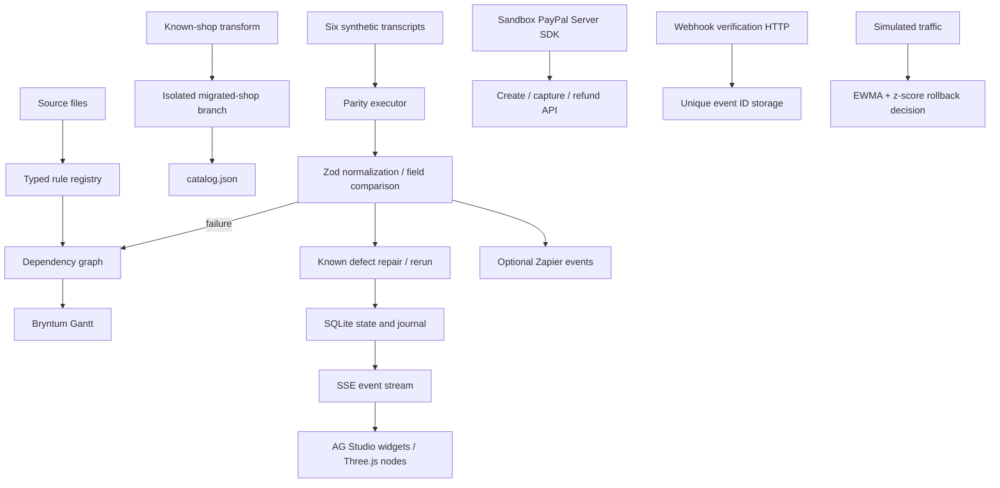

# Architecture

Engine functions in `packages/engine` are pure and browser-independent. Agent roles and structured provider outputs are in `packages/agents`. Web server effects are in `apps/web/lib/store.ts`; SQLite tables are initialized on demand. The unused Drizzle proxy was removed during the judge audit; the demo uses Node SQLite directly for synchronous journals and flags. PHP uses PDO SQLite separately.

Boundaries validate incoming actions, assistant prompts and responses, webhook IDs and fixtures with Zod. Monetary comparisons retain two-decimal strings. Notification ordering is normalized; duplicates remain observable. Timestamps and opaque provider IDs are intentionally excluded from parity. The six fixtures are deterministic synthetic examples, not real HTTP recordings.

Live SDK and webhook APIs are isolated from replay. A live parity request is rejected because full buyer approval automation is absent. No evidence is relabelled. The generated PHP template is reviewable, sandbox-only code; applying it never cuts traffic over.

The shopping demo adds a deterministic tool policy in `apps/web/lib/shopping-agent.ts`. It reads the generated catalog, blocks the legacy NVP contract, and uses the official PayPal Agent Toolkit function interface for sandbox Orders creation/capture. The default simulation never calls PayPal. Browser-owned agent orders and mode-separated webhook receipts use additional tables in the existing web SQLite file. Capture alone leaves an order awaiting its webhook; signature verification precedes an atomic, amount/currency/order/capture-matched settlement. This web agent shop is distinct from the standalone PHP shop database.

Passports persist issued snapshots per seeded site in the existing state store. Only Horizon has local parity and shopping evidence. The engine's Node-only `passport` subpath creates and verifies a canonical SHA-256 chain; `passport-pdf.ts` renders its summary with pdf-lib. The browser imports only erased passport types. Estimate inputs and a configurable merchant sunset target are included in the chain. A separately retained head detects a replaced chain; the chain is not an issuer signature.

The Node-only `verification` engine subpath is shared by the CLI and `GET /api/verify`. It validates the complete scenario set and compares fixture outcomes under the idempotent contract without executing the dashboard's repair loop. `packages/cli` exposes `sundown verify` and writes reports even for invalid or failing scenarios. The reusable composite action runs that CLI from its own installed source against the caller's fixtures, propagates failure, and uploads reports/Postman artifacts in an always-run step.
